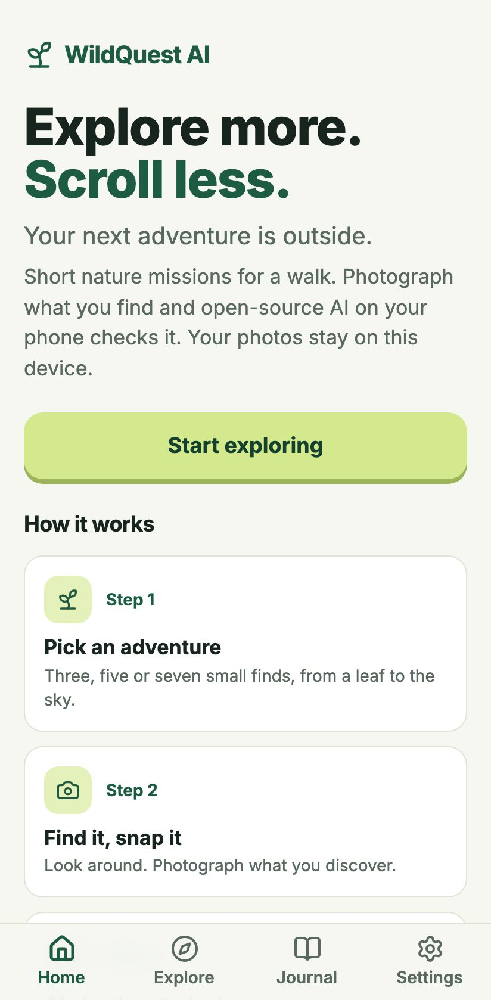
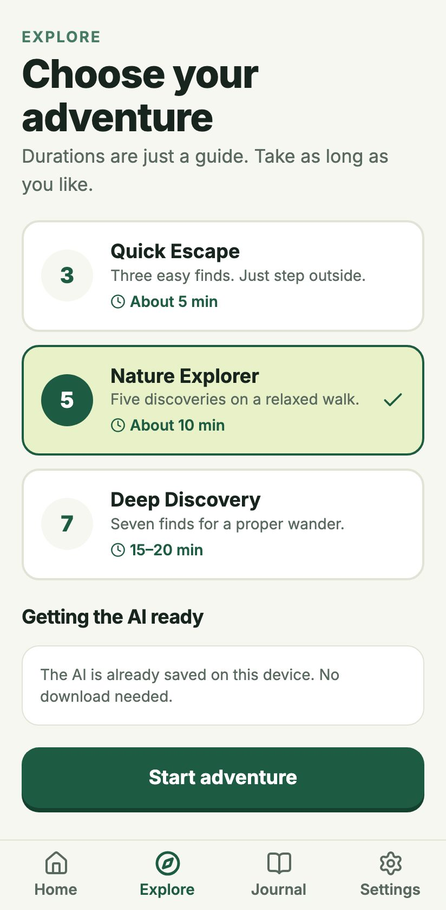
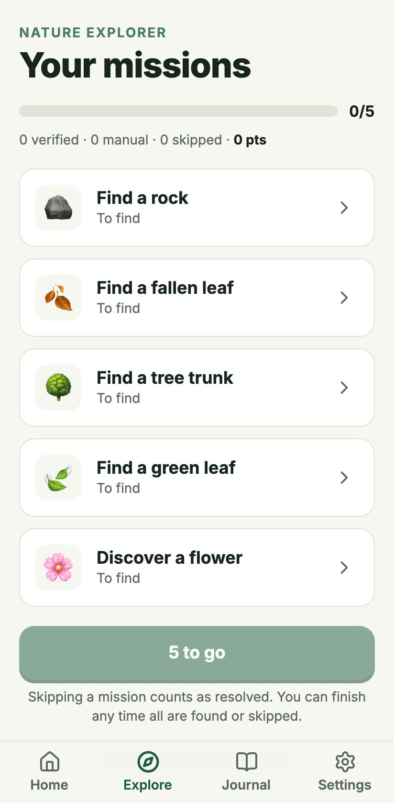
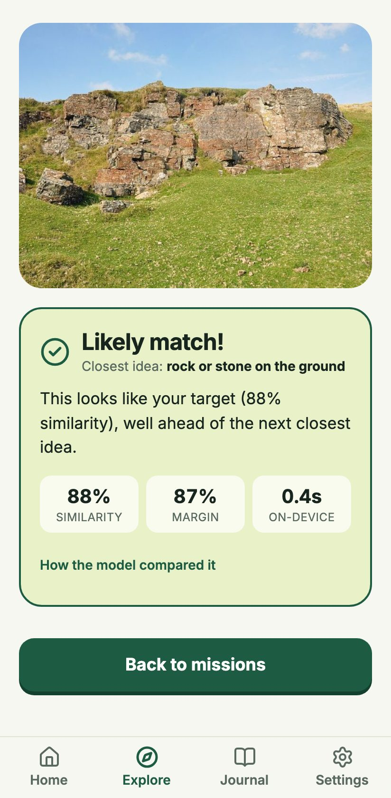
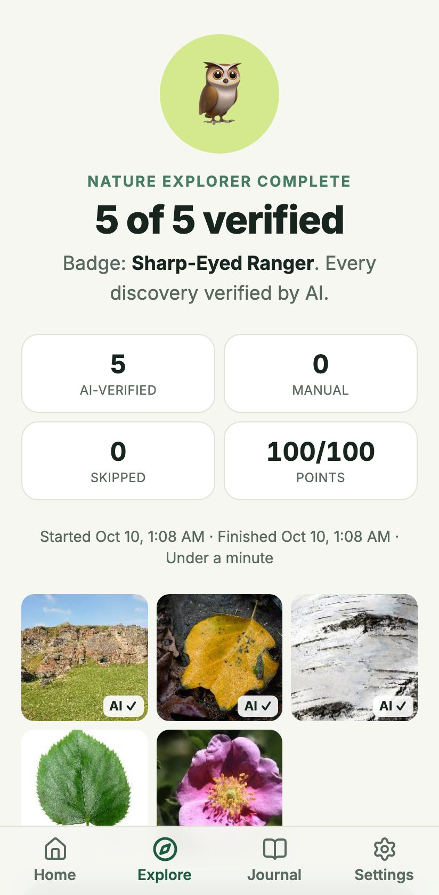
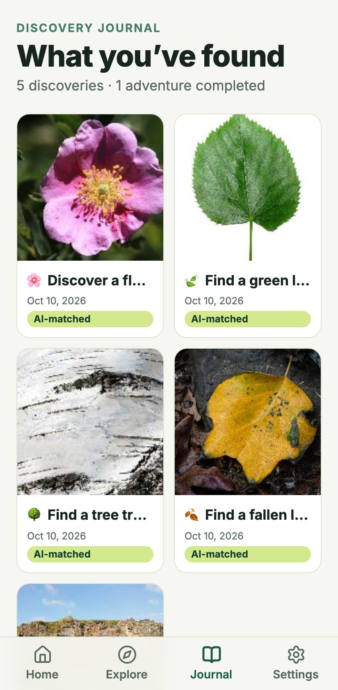
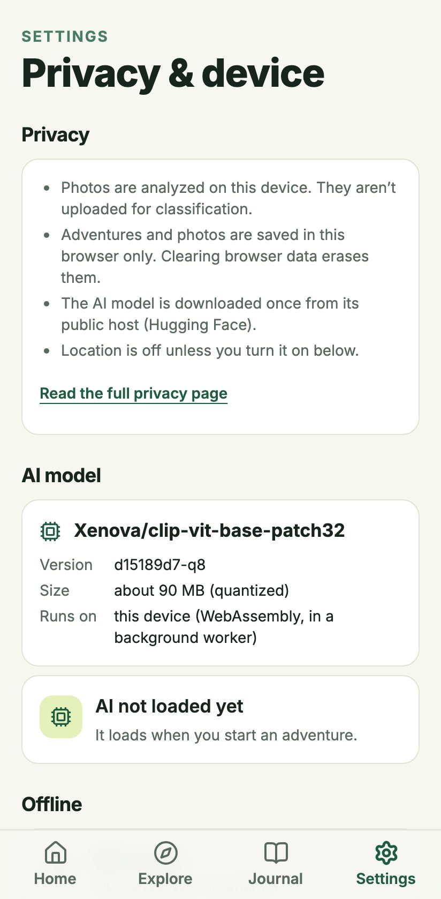
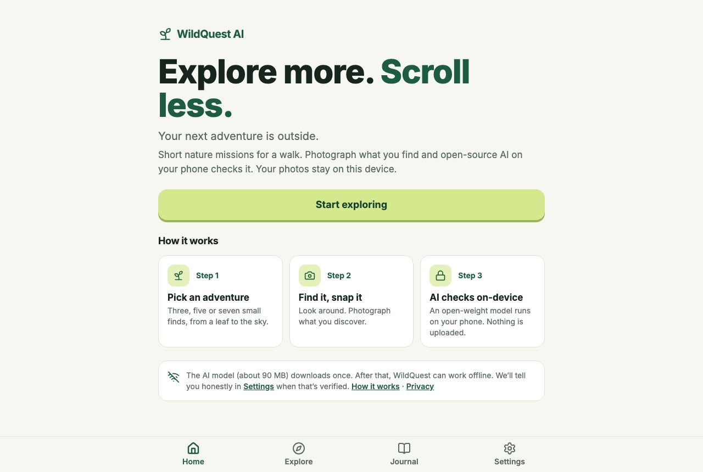

<div align="center">

# 🌿 WildQuest AI

### Explore more. Scroll less. Your next adventure is outside.

WildQuest AI turns a short walk into a nature-discovery game. Get a handful of small
missions — find a green leaf, a flower, a tree trunk, the sky — photograph what you
find, and an **open-weight vision model running entirely on your own device** checks
each photo. When you finish, the app tells you to put the phone away.

Built for the [DEV Hacktoberfest Open-Source AI Challenge · Week 1: Touch Grass](https://dev.to/challenges/hacktoberfest-week1-2026-10-05).

<br/>


</div>

---

## 📸 Screens

|  |  |  |  |
|:--:|:--:|:--:|:--:|
|  |  |  |  |
| **Home** | **Explore** | **Missions** | **Result** |
|  |  |  |  |
| **Complete** | **Journal** | **Settings** | **Desktop** |

> Screenshots use real photos with a **stubbed score** from the mock-AI test build, so they're
> deterministic. Real model behavior is covered by `tests/e2e/real.spec.ts` and `docs/EVALUATION.md`.

---

## 📑 Contents

- [What it does & the problem it solves](#-what-it-does--the-problem-it-solves)
- [Why it fits "Touch Grass"](#-why-it-fits-touch-grass)
- [The open-weight model](#-the-open-weight-model)
- [Architecture](#-architecture)
- [Quick start](#-quick-start)
- [Deploy](#-deploy)
- [How browser AI inference works](#-how-browser-ai-inference-works)
- [Privacy design](#-privacy-design)
- [Offline setup & verified limitations](#-offline-setup--verified-limitations)
- [Model limitations](#-model-limitations)
- [Testing](#-testing)
- [Credits & licenses](#-credits--licenses)

---

## 🎯 What it does & the problem it solves

Most apps are built to keep your eyes on the screen. WildQuest uses the screen as a small
nudge to leave it: a few concrete things to look for outdoors, a fair check on whether you
found them, and a calm ending that sends you back outside.

**No accounts. No feeds. No streaks.** Just three, five, or seven small missions, roughly
5, 10, or 15–20 minutes outside.

---

## 🌱 Why it fits "Touch Grass"

- **The mission *is* the outdoors** — leaves, flowers, bark, sky, grass, rocks, fallen
  leaves, all found in parks and gardens. Safety notes are attached where needed; no mission
  involves wildlife, roads, or trespassing.
- **Sessions are short** (≈5, 10, or 15–20 minutes) and end with *"Now put the phone away."*
- **The AI does real work.** It isn't decoration — it decides whether a photo plausibly
  contains the target.

---

## 🧠 The open-weight model

**`Xenova/clip-vit-base-patch32`** — OpenAI's CLIP ViT-B/32 (MIT), converted to ONNX,
quantized (q8, ~90 MB), pinned to commit `d15189d7…`.

It runs via [Transformers.js](https://github.com/huggingface/transformers.js)
(`zero-shot-image-classification`) on ONNX Runtime Web (WASM), inside a Web Worker.

> **No paid API. No inference server. Nothing trained** — a mission is just a sentence that
> CLIP scores a photo against.

---

## 🏗 Architecture

```
  Camera / file picker
        │  validate type + size, apply EXIF rotation
        ▼
  Canvas: 448 px copy for the model  +  720 px JPEG + 256 px thumbnail for the journal
        │ RGB pixels (postMessage)
        ▼
  ┌───────────── Web Worker ─────────────┐        ┌──────────── main thread ────────────┐
  │ Transformers.js + ONNX Runtime WASM  │ scores │ verify(): pure decision rule        │
  │ CLIP image ↔ mission text prompts    │ ─────► │ matched | uncertain | mismatch | err│
  └──────────────────────────────────────┘        └──────────────────┬──────────────────┘
        ▲ weights (Cache Storage, 1 download)                         │ one Dexie transaction
        │                                                             ▼
  Service worker caches app shell + WASM                IndexedDB: adventures, sessionMissions,
                                                        discoveries (thumbnail + photo), settings
```

<details>
<summary><strong>Key modules</strong></summary>

| Concern | Where |
|---|---|
| Mission catalogue, adventure modes, selection | `lib/missions.ts` |
| Decision rule (pure) and thresholds | `lib/ai/verify.ts`, `lib/ai/config.ts` |
| Worker, client engine (state, timeout, stale responses), offline self-test | `lib/ai/classifier.worker.ts`, `lib/ai/classifier.ts` |
| Image validation, resize, orientation, thumbnails | `lib/image.ts` |
| State machine, points, summary (pure) | `lib/session.ts` |
| Dexie schema, migrations, transactions | `lib/db.ts` |
| Offline state machine | `lib/offline.ts`, `public/sw.js` |
| Screens | `app/*`, `components/*` |

</details>

<details>
<summary><strong>Routes & state machine</strong></summary>

**Routes:** `/` home · `/explore` modes · `/adventure/[id]` session ·
`/adventure/[id]/complete` summary · `/journal` · `/settings` · `/about` · `/privacy`.

Adventure ids exist only at runtime (IndexedDB), so a static export can't pre-render them:
one static shell (`app/adventure/[[...slug]]`) serves every id and reads the real URL.
Hosting must rewrite `/adventure/*` to it (see [Deploy](#-deploy)).

**Mission states:** `pending → analyzing → matched`, `pending → manual`,
`pending → skipped`, `analyzing → pending` (uncertain/error), `skipped → pending` (undo).
`matched` and `manual` are final. All writes are single Dexie transactions that re-check
state, so double taps and repeated responses can't double-award points.

</details>

---

## 🚀 Quick start

```bash
npm ci        # installs, and copies the ONNX WASM runtime into public/ort
npm run dev   # → http://localhost:3000 (service worker disabled in dev)
```

Needs **Node 20+**. The first AI use downloads the model (~90 MB) from Hugging Face.
Phones need HTTPS for the camera — use a tunnel or the deployed URL.

---

## 🌐 Deploy

Static export to any HTTPS static host. Render is configured in `render.yaml`:

```bash
npm run build   # → out/
npm start       # serves out/ locally with the same /adventure/* rewrite as production
```

On Render: create a new **Blueprint** from this repo, or a Static Site with build
`npm ci && npm run build`, publish `out`, and a **rewrite rule
`/adventure/*` → `/adventure/index.html`** (needed for refreshing or sharing
`/adventure/12/`). The service worker also falls back to the same shell when offline.

> ⚠️ Not yet verified on Render itself. `scripts/serve.mjs` reproduces the rewrite and is
> what the browser tests run against.

---

## 🔬 How browser AI inference works

1. **First use:** the worker downloads the quantized CLIP weights, tokenizer, and configs
   into the browser's Cache Storage and initializes ONNX Runtime (WASM, single thread for
   compatibility).
2. A photo is decoded, rotated by EXIF, resized to ≤448 px, and sent to the worker as raw RGB.
3. Each mission carries text prompts: its **target**, optional **aliases**, a few curated
   **look-alikes**, shared **negatives** (building, person, indoor room, car), and **every
   other mission's target**. CLIP scores the image against all of them.
4. `verify()` accepts only if the target (or alias) ranks first, its score is ≥ 0.45, and it
   leads the best competitor by ≥ 0.15. A clear win for something else is `mismatch`;
   anything in between is `uncertain`. These are *relative similarities across the prompts*,
   never described as probabilities.
5. One request is processed at a time, with a 60 s timeout (the worker is replaced if stuck),
   and late responses for cancelled requests are dropped.

---

## 🔒 Privacy design

- **Photos are classified on the device.** There is no classification server and no analytics.
- **Everything is stored in this browser** (IndexedDB). No login.
- Photos can be deleted one by one or all at once in Settings. Clearing browser data also
  erases them.
- The model downloads once from Hugging Face's public host. That reveals your IP to them,
  like any download.
- **Location is off by default** — requested only when you flip the toggle, rounded to ~1 km,
  stored locally, and not shown unless you reveal it.
- **Verified by test:** `tests/e2e/real.spec.ts` records every network request during a real
  session and asserts there are no non-GET requests, no request bodies, and no hosts other
  than localhost and Hugging Face.

---

## 📴 Offline setup & verified limitations

Settings → Offline has five honest states:

`NOT_READY` · `DOWNLOADING` · `READY_UNVERIFIED` · `OFFLINE_READY` · `ERROR`

**`OFFLINE_READY` is only shown after a real test:** a fresh worker loads the model with all
cross-origin network access blocked (through Transformers.js' own `env.fetch` hook) and runs
an inference — **and** the service worker, app pages, WASM runtime, and model are all still
present right now.

What we verified in `tests/e2e/real.spec.ts` (Chromium):
> download → "Offline ready" → network disabled → reload → reopen an adventure →
> analyze a new photo with the real model → match, saved.

<details>
<summary><strong>Things we learned the hard way, now handled</strong></summary>

- Transformers.js binds `fetch` at import, so patching `self.fetch` doesn't block anything.
  The self-test uses `env.fetch`.
- The library probes the `main` revision for `tokenizer_config.json` and
  `preprocessor_config.json` even when you pin a commit, which breaks offline loading. After
  loading we alias those files under the `main` keys. We confirmed the self-test **fails**
  (shows an error, never "Offline ready") when this fix is disabled.

</details>

**Known limits:** needs one online visit first; browsers may evict storage under pressure
(we re-check on every visit and downgrade the badge, and request persistent storage); iOS
Safari evicts more aggressively; only tested in desktop Chromium so far.

---

## ⚖️ Model limitations

See [`docs/EVALUATION.md`](docs/EVALUATION.md). In short, on 76 Wikimedia photos:

| Metric | Result |
|---|---|
| False positives on 405 sharp negative pairs | **0** |
| Correct photos accepted | **46 / 50** (92%) |
| Held-out correct photos accepted | **21 / 22** |
| Heavily blurred correct photos passing | ~half |
| Wrong blurred pairs that matched | 2 / 300 |

The sample is small, not phone-shot, and was used to shape prompts, so treat it as
**indicative only**. CLIP can be fooled by look-alikes, and anyone can photograph a picture
of a leaf — this is a nudge, not proof.

**Devices:** the model needs ~90 MB of storage and enough memory for WASM inference.
Unsupported browsers, low-memory devices, out-of-memory errors, offline-without-cache,
download failures, and timeouts each show a specific message with a retry, plus a **manual
logging fallback** (stored as `manual`, no AI points). We never substitute simulated results.

---

## 🧪 Testing

```bash
npm run typecheck && npm run lint
npm test                # 52 unit tests: missions, verify rule, state machine, points,
                        #   summary, Dexie transactions & deletion (fake-indexeddb)
npm run build:all       # production build + mock-AI build (NEXT_PUBLIC_E2E=1)
npm run test:e2e:mock   # 17 Playwright flow tests with deterministic mocked AI scores
npm run test:e2e:real   # 3 tests, real CLIP in Chromium: inference, no uploads,
                        #   persistence, offline, unsupported browser (needs internet once)
npm run eval            # evaluation harness on eval/dev; add -- --set=heldout, -- --sweep
node scripts/screenshots.mjs
```

The mock hook (`window.__WQ_MOCK_AI__`) is honored only when built with `NEXT_PUBLIC_E2E=1`.
The real test installs a throwing mock and shows the production build ignores it.

> **Not tested:** physical Android/iOS phones (camera capture, memory, performance),
> Safari/Firefox, a real outdoor walk, the Render deployment, and Lighthouse/PWA install
> audits. These need a person with a device.

---

## 📜 Credits & licenses

See [`NOTICE.md`](NOTICE.md).

**CLIP** (MIT, OpenAI) · Xenova ONNX conversion · **Transformers.js** (Apache-2.0) ·
**ONNX Runtime** (MIT) · Next.js, React, Tailwind, Dexie, Lucide (MIT/ISC) · Inter (SIL OFL).

Evaluation photos: Wikimedia Commons, individual licenses in `eval/*/CREDITS.md`.

<div align="center">
<br/>

**🌿 Explore more. Scroll less. Your next adventure is outside.**

</div>
